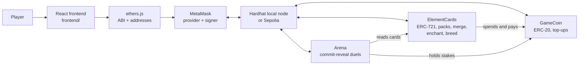

# Elemental Duel

An on-chain creature card game built for **COMP7610 Introduction to Web3 and Blockchain** (HKU).
Players top up with ETH to get Duel Coin, open packs to mint creature card NFTs, make their cards
stronger, and stake coins in duels that use commit-reveal so nobody can peek at the other player's
card.

> **Status:** all three contracts and every page are implemented and tested on a local chain.
> Next: deploy to Sepolia. See [docs/PLAN.md](docs/PLAN.md) for the task split and timeline.

## Gameplay

| Action | What happens on-chain |
| --- | --- |
| **Top up** | Pay ETH; `GameCoin` mints Duel Coin (DUEL) at a fixed 1 ETH = 1,000,000 DUEL. Top-ups are one-way. |
| **Open a pack** | Pay 1,000 DUEL; `ElementCards` mints one ERC-721 card of a random species and power. |
| **Merge** | Burn three cards of the same rarity for free; mint one random card of the next rarity. |
| **Decompose** | Burn a card and receive coins, worth less than the card cost to get. |
| **Enchant** | Pay coins to give a card one random passive. Enchanting again replaces it. |
| **Breed** | Pay coins to mint a child from one male and one female card. The parents stay yours but rest afterwards. |
| **Duel** | Both players commit `hash(ordered tokenIds[3], salt, address)` and stake the same coins, then reveal. A deterministic 3v3 relay with one global 20-round limit decides the pot. |

- **Species:** 136 Pals from `palworld-dataset.json`, in its existing array order. `speciesId`
  is the array index, locked in `scripts/species-order.json`. Official keys match `codename`;
  images match each record's `slug` and are served from `frontend/public/pals/`.
- **Rarities:** Common 70%, Rare 25%, Legendary 5%, retaining the original prices and merge rules.
  Official rarity 1–4 / 5–9 / 10+ maps to these three economic tiers only; it never changes combat stats.
- **Elements:** Water beats Fire. Fire beats Grass and Ice. Grass beats Ground. Ground beats
  Electric. Electric beats Water. Ice beats Dragon. Dragon beats Dark. Dark beats Neutral.
  A strength uses E=12500, reverse resistance E=8000, otherwise E=10000 (basis points).
  Only the primary element attacks; multiply both defense elements, ignore None, then clamp to 7000–15000.
- **Battle:** official Hp → MaxHP, ShotAttack → ATK, Defense → DEF, with no scaling.
  Every round both cards simultaneously deal
  `max(1, floor(ATK * E * 100 / (10000 * (100 + enemy DEF))))` damage.
  Each player commits three different NFT IDs in a fixed order. The current pair attacks
  simultaneously; fallen cards are replaced next round, survivors keep HP, and damage never
  spills onto the bench. Eliminating the opposing team wins; simultaneous team elimination draws.
  The whole battle lasts at most 20 rounds. At the limit compare the exact sum of
  `remaining HP / MaxHP` for all three cards, including full-health unused cards and zero-HP
  fallen cards. Equal sums draw. The frontend relay uses BigInt and the contract cross-multiplies
  exact fractions without rounding percentages.
  No speed, active skills, critical hits, dodge or random combat modifiers are used.
- **Passives:** each card has at most one. Enchanting rolls the five effects with equal odds,
  replacing the previous passive (the same passive can roll again). New and bred cards have none.
  Pierce ignores 20% of target DEF; Underdog deals 20% more damage at or below half HP at the
  start of a round; Resonance deals 5% more per other teammate with the same primary element
  (up to 10%, including knocked-out teammates); Guard reduces incoming damage by 10%; Focus
  deals 25% more on that card's first attack of the battle, including replacements.
  Apply Pierce to DEF, compute base damage, apply attack bonuses, then Guard. Round down at
  each step; final damage is at least 1. Both triggers read the state before either attack lands.
  Base stats stay unchanged; the original random `power` field has no effect in combat.
- **Gender:** every card is male or female, rolled at random when it is minted.
- **Breeding:** the parents must be one male and one female. A special recipe wins if one exists. Otherwise the child is the species whose
  breeding rank is closest to the average of the parents' ranks, with lower species ID breaking ties.
  Ranks use `combiRank`; 28 primary-parent recipes use the dataset's `specialCombos`.
  The existing averaging rule is retained; `ignoreCombi`, `combiDuplicatePriority`, and ambiguous
  `altLegendaryParent` metadata do not introduce additional breeding rules in this version.

| Rarity | Decompose for | Enchant | Breed a child |
| --- | --- | --- | --- |
| Common | 300 DUEL | 200 DUEL | 500 DUEL |
| Rare | 900 DUEL | 500 DUEL | 1,500 DUEL |
| Legendary | 2,700 DUEL | 1,000 DUEL | 4,500 DUEL |

## Pages

The coin balance stays visible in the header on every page.

| Page | What you can do |
| --- | --- |
| **Home** | New players see an introduction. Returning players see a live dashboard, refreshed every 10 seconds: coins, cards owned, battle record, net battle earnings, highest ATK card, what needs attention (reveal countdowns, timeouts, open battles to join, cards ready to merge, low coins) and recent results. |
| **Top Up** | Buy coins with ETH, using a preset or any whole number of coins. |
| **Shop** | Open a pack and watch the new card flip over. |
| **My Cards** | See every card you own, filter by rarity and element, and sort by ATK. |
| **Forge** | Four tabs: Merge (or let the page pick the three lowest-ATK cards), Enchant, Decompose and Breed. Breed has one male and one female slot: clicking a slot greys out the other gender, and the page previews the child and its fee. A card committed to a battle cannot be merged or decomposed here. |
| **Arena** | Create or join a battle with an ordered three-card team and a stake in coins, reveal before the countdown ends, settle a timeout, or cancel a battle nobody has joined. Active battles show both teams: only you can see yours before you reveal, and your opponent's team stays face down until they reveal. Cancelled and finished battles leave this list. |
| **History** | Your last 20 finished battles, with both teams, damage per round and an expandable deterministic round replay, the result and the coins won or lost. Cards appear as they were when revealed, even if they were merged or decomposed later. |
| **Rules** | Drop rates, prices and all 136 species, read directly from the contract, plus the element chart and passives. |

## Why a blockchain?

- **Players own their cards.** Cards are standard ERC-721 tokens held in the player's wallet,
  not rows in a company database.
- **Auditable odds and prices.** Drop rates and prices are written into a deployed contract that
  nobody can change, unlike opaque loot-box odds in Web2 games.
- **Trustless stakes.** The Arena contract escrows both stakes and pays the winner by its own
  rules; no operator can withhold the pot.
- **Composability.** `Arena` reads card data straight from `ElementCards`, and both spend the same
  `GameCoin`, the "Lego block" property of smart contracts.

## Architecture



## Repository layout

```text
contracts/                 Hardhat 3 project
  contracts/GameCoin.sol       in-game ERC-20, top-ups with ETH
  contracts/ElementCards.sol   card NFT, species, packs, merge, decompose, enchant, breed
  contracts/Arena.sol          staked commit-reveal battles
  contracts/mocks/             test-only card contract with chosen attributes (never deploy)
  test/                        mocha tests for both contracts
  scripts/deploy.ts            deploy all contracts, authorize them and update the frontend config
  scripts/export-abi.ts        copy ABIs into the frontend
frontend/                  Vite + React + ethers v6
  src/config/                  chains, contract addresses, ABIs, prices, species names
  src/hooks/                   useWallet, useCoins, useTx, useMyCards, useBattles, useNow
  src/components/              Header, WalletGate, Card, BattleCards, TxStatus
  src/pages/                   Home, TopUp, Shop, Collection, Forge, Arena, History, Odds (Rules)
  src/lib/                     game rules, commit-reveal helpers, error messages, formatting
docs/
  INTERFACE.md                 contract interface
  PLAN.md                      team roles, timeline and conventions (Chinese)
```

## Prerequisites

- [Node.js](https://nodejs.org/) 22 LTS or newer, with npm
- [MetaMask](https://metamask.io/download/) in a desktop browser
- For Sepolia only: a little Sepolia ETH from a faucet listed on
  [ethereum.org](https://ethereum.org/developers/docs/networks/#sepolia)

## Run locally

Local development uses a Hardhat node: free test ETH, instant blocks, unlimited redeploys.

**1. Verify generated species and images, then test the contracts**

```bash
node scripts/sync-palworld.mjs --check
# After intentionally editing the source dataset, regenerate with:
# node scripts/sync-palworld.mjs
```

This uses only the JSON files and slug-matched PNG files, never Excel. The check validates
all official core fields, chain/frontend fixed order, recipes, and all 136 image copies.
Changing the species order requires an explicit migration. The new Card/Species structs and
battle helpers require fresh `ElementCards` and `Arena` deployments and exported ABIs;
existing deployed bytecode is not upgraded by editing files.
The passive battle rules also require a fresh Arena deployment; the Card structure and
commitment format are unchanged from the 3v3 relay version.

**Install and test:**

```bash
cd contracts
npm install
npm test
```

**2. Start a local chain** (keep this terminal open)

```bash
npm run node
```

It prints 20 test accounts with 10,000 ETH each, and their private keys.

**3. Deploy** (in a second terminal, inside `contracts/`)

```bash
npm run deploy:local
```

This writes the contract addresses to `frontend/src/config/deployments.json` and the ABIs to
`frontend/src/config/abi/`.

**4. Start the frontend** (in a third terminal)

```bash
cd frontend
npm install
npm run dev
```

Open the printed URL (usually <http://localhost:5173>) and click **Connect MetaMask**. The DApp
asks MetaMask to add the "Hardhat Local" network (chain ID 31337).

**5. Use a test account in MetaMask.** In MetaMask choose *Add account → Import account* and
paste one of the private keys printed in step 2.

> ⚠️ Those keys are public and identical on every machine. Use them only on the local chain;
> never send real funds to them.

**6. Try a duel.** Import a second test account the same way, then connect it to the site from
MetaMask's connected accounts settings. Until you do, the page keeps showing the first account.
With the first account, top up, open at least three packs, pick and order three cards in the Arena and create a battle. Switch MetaMask to the
second account, top up, open at least three packs, then pick and order three cards to join the battle. Each account reveals its team, and the second
reveal settles the battle. The result then appears on the Home dashboard and in History.

**After restarting the local node**, reset MetaMask's cached nonce for each test account, with
Hardhat Local selected: *Settings → Developer tools → Delete activity and nonce data*. Older
MetaMask versions have this under *Settings → Advanced → Clear activity tab data*. Otherwise
transactions fail with a nonce error.

## Deploy to Sepolia

Deploying with Remix and MetaMask keeps private keys out of every file.

1. In [Remix](https://remix.ethereum.org/), create `GameCoin.sol`, `ElementCards.sol` and
   `Arena.sol` with the contents of `contracts/contracts/` (skip `mocks/`, which is for tests
   only). Remix downloads the OpenZeppelin imports automatically.
2. Compile with Solidity 0.8.28 or newer, with **optimization enabled** (200 runs). Without it
   `ElementCards` can exceed the contract size limit.
3. In *Deploy & Run*, choose **Injected Provider - MetaMask** with MetaMask on Sepolia.
4. Deploy `GameCoin`. Deploy `ElementCards` with the coin's address as the constructor argument,
   then `Arena` with the card contract's address. On `GameCoin`, call `setGameContract` twice, with
   each of those two addresses and `true`. Until then, packs and stakes fail with `NotGameContract`.
5. Add the three addresses to `frontend/src/config/deployments.json`:

   ```json
   {
     "11155111": { "GameCoin": "0x...", "ElementCards": "0x...", "Arena": "0x..." }
   }
   ```

6. Create `frontend/.env` from `frontend/.env.example`, set `VITE_CHAIN_ID=11155111`, and
   restart `npm run dev`.

Alternatively, deploy from the command line: store `SEPOLIA_RPC_URL` and `SEPOLIA_PRIVATE_KEY`
with `npx hardhat keystore set <NAME>`, then run
`npx hardhat run scripts/deploy.ts --network sepolia` in `contracts/`.

## Commands

| Where | Command | Purpose |
| --- | --- | --- |
| `contracts/` | `npm run build` | Compile the contracts |
| `contracts/` | `npm test` | Run the tests |
| `contracts/` | `npm run node` | Start the local chain on port 8545 |
| `contracts/` | `npm run deploy:local` | Deploy to the local chain and update the frontend config |
| `contracts/` | `npm run export-abi` | Refresh the frontend ABIs after changing a contract |
| `frontend/` | `npm run dev` | Start the development server |
| `frontend/` | `npm run build` | Build the static site into `frontend/dist/` |

## Team

| Member | Role |
| --- | --- |
| _TBD_ | Contracts: ElementCards, technical lead |
| _TBD_ | Contracts: Arena, security |
| _TBD_ | Frontend: wallet, shop, collection, drop rates |
| _TBD_ | Frontend: forge, arena, visual design |
| _TBD_ | Project management, testing, report, video |

## Acknowledgements

- The wallet connection and transaction-handling code started from the course's NFT-ticket
  starter ([jzjzzzzzzz/nft-ticket-dapp](https://github.com/jzjzzzzzzz/nft-ticket-dapp)).
- Token standards come from [OpenZeppelin Contracts](https://docs.openzeppelin.com/contracts/5.x/).
- Palworld species data and character artwork are used for this course project. The game dataset
  is `palworld-dataset.json`; official stat verification uses `DT_PalMonsterParameter_Common.json`.
  Slug-matched source images are in `art-references/palworld-fullbody/site-images/`, with runtime
  copies in `frontend/public/pals/`.
- On-chain randomness here uses `block.prevrandao`, which validators can influence. It is
  adequate for a course demo; a production game would use a verifiable randomness oracle
  such as Chainlink VRF.
