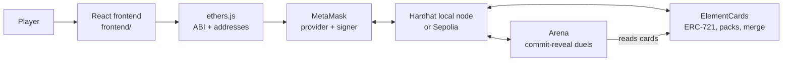

# Elemental Duel

An on-chain card game built for **COMP7610 Introduction to Web3 and Blockchain** (HKU).
Players open packs to mint elemental card NFTs, merge duplicates into rarer cards, and
stake ETH in duels that use commit-reveal so nobody can peek at the other player's card.

> **Status:** both contracts and every page are implemented and tested on a local chain.
> Next: deploy to Sepolia. See [docs/PLAN.md](docs/PLAN.md) for the task split and timeline.

## Gameplay

| Action | What happens on-chain |
| --- | --- |
| **Open a pack** | Pay 0.001 ETH; `ElementCards` mints one ERC-721 card with a random element, rarity and power. |
| **Merge** | Burn three cards of the same rarity; mint one card of the next rarity. |
| **Duel** | Both players commit `hash(card, salt, address)` and stake the same ETH, then reveal. The stronger card wins the pot. |

- **Elements:** 🔥 Fire beats 🌿 Wood, 🌿 Wood beats 💧 Water, 💧 Water beats 🔥 Fire.
  A card with the element advantage fights at 1.5x power.
- **Rarities:** Common 70% (power 10–39), Rare 25% (40–69), Legendary 5% (70–100).
  The rates are public constants in the contract.

## Pages

| Page | What you can do |
| --- | --- |
| **Home** | New players see an introduction. Returning players see a live dashboard, refreshed every 10 seconds: cards owned, battle record, net battle earnings, strongest card, what needs attention (reveal countdowns, timeouts, open battles to join, cards ready to merge) and recent results. |
| **Shop** | Open a pack and watch the new card flip over. |
| **My Cards** | See every card you own, filter by rarity and element, and sort by power. |
| **Forge** | Pick three cards of one rarity, or let the page pick the three weakest, and merge them. |
| **Arena** | Create or join a battle with a chosen card and stake, reveal before the countdown ends, settle a timeout, or cancel a battle nobody has joined. Active battles show both cards: only you can see yours before you reveal, and your opponent's stays face down until they reveal. Cancelled and finished battles leave this list. |
| **History** | Your last 20 finished battles, with both cards, any element bonus, the result and the ETH won or lost. Cards appear as they were when revealed, even if they were merged or transferred later. |
| **Drop Rates** | The drop rates and power ranges, read directly from the contract. |

## Why a blockchain?

- **Players own their cards.** Cards are standard ERC-721 tokens held in the player's wallet,
  not rows in a company database.
- **Auditable odds.** Drop rates are written into a deployed contract that nobody can change,
  unlike opaque loot-box odds in Web2 games.
- **Trustless stakes.** The Arena contract escrows both stakes and pays the winner by its own
  rules; no operator can withhold the pot.
- **Composability.** `Arena` reads card data straight from `ElementCards`, the "Lego block"
  property of smart contracts.

## Architecture



## Repository layout

```text
contracts/                 Hardhat 3 project
  contracts/ElementCards.sol   card NFT, packs, merging
  contracts/Arena.sol          staked commit-reveal battles
  contracts/mocks/             test-only card contract with chosen attributes (never deploy)
  test/                        mocha tests for both contracts
  scripts/deploy.ts            deploy both contracts and update the frontend config
  scripts/export-abi.ts        copy ABIs into the frontend
frontend/                  Vite + React + ethers v6
  src/config/                  chains, contract addresses (deployments.json) and ABIs
  src/hooks/                   useWallet, useTx, useMyCards, useBattles, useNow
  src/components/              Header, WalletGate, Card, BattleCards, TxStatus
  src/pages/                   Home, Shop, Collection, Forge, Arena, History, Odds
  src/lib/                     game rules, commit-reveal helpers, error messages, formatting
docs/
  INTERFACE.md                 frozen contract interface
  PLAN.md                      team roles, timeline and conventions (Chinese)
```

## Prerequisites

- [Node.js](https://nodejs.org/) 22 LTS or newer, with npm
- [MetaMask](https://metamask.io/download/) in a desktop browser
- For Sepolia only: a little Sepolia ETH from a faucet listed on
  [ethereum.org](https://ethereum.org/developers/docs/networks/#sepolia)

## Run locally

Local development uses a Hardhat node: free test ETH, instant blocks, unlimited redeploys.

**1. Install and test the contracts**

```bash
cd contracts
npm install
npm test
```

**2. Start a local chain** (keep this terminal open)

```bash
npm run node
```

It prints 20 test accounts with 10,000 ETH each, and their private keys.

**3. Deploy** (in a second terminal, inside `contracts/`)

```bash
npm run deploy:local
```

This writes the contract addresses to `frontend/src/config/deployments.json` and the ABIs to
`frontend/src/config/abi/`.

**4. Start the frontend** (in a third terminal)

```bash
cd frontend
npm install
npm run dev
```

Open the printed URL (usually <http://localhost:5173>) and click **Connect MetaMask**. The DApp
asks MetaMask to add the "Hardhat Local" network (chain ID 31337).

**5. Use a test account in MetaMask.** In MetaMask choose *Add account → Import account* and
paste one of the private keys printed in step 2.

> ⚠️ Those keys are public and identical on every machine. Use them only on the local chain;
> never send real funds to them.

**6. Try a duel.** Import a second test account the same way, then connect it to the site from
MetaMask's connected accounts settings. Until you do, the page keeps showing the first account.
With the first account, pick a card in the Arena and create a battle. Switch MetaMask to the
second account, open a pack, then join the battle. Each account reveals its card, and the second
reveal settles the battle. The result then appears on the Home dashboard and in History.

**After restarting the local node**, reset MetaMask's cached nonce for each test account, with
Hardhat Local selected: *Settings → Developer tools → Delete activity and nonce data*. Older
MetaMask versions have this under *Settings → Advanced → Clear activity tab data*. Otherwise
transactions fail with a nonce error.

## Deploy to Sepolia

Deploying with Remix and MetaMask keeps private keys out of every file.

1. In [Remix](https://remix.ethereum.org/), create `ElementCards.sol` and `Arena.sol` with the
   contents of `contracts/contracts/` (skip `mocks/`, which is for tests only). Remix downloads the OpenZeppelin imports automatically.
2. Compile with Solidity 0.8.28 or newer.
3. In *Deploy & Run*, choose **Injected Provider - MetaMask** with MetaMask on Sepolia.
4. Deploy `ElementCards`, copy its address, then deploy `Arena` with that address as the
   constructor argument.
5. Add both addresses to `frontend/src/config/deployments.json`:

   ```json
   {
     "11155111": { "ElementCards": "0x...", "Arena": "0x..." }
   }
   ```

6. Create `frontend/.env` from `frontend/.env.example`, set `VITE_CHAIN_ID=11155111`, and
   restart `npm run dev`.

Alternatively, deploy from the command line: store `SEPOLIA_RPC_URL` and `SEPOLIA_PRIVATE_KEY`
with `npx hardhat keystore set <NAME>`, then run
`npx hardhat run scripts/deploy.ts --network sepolia` in `contracts/`.

## Commands

| Where | Command | Purpose |
| --- | --- | --- |
| `contracts/` | `npm run build` | Compile the contracts |
| `contracts/` | `npm test` | Run the tests |
| `contracts/` | `npm run node` | Start the local chain on port 8545 |
| `contracts/` | `npm run deploy:local` | Deploy to the local chain and update the frontend config |
| `contracts/` | `npm run export-abi` | Refresh the frontend ABIs after changing a contract |
| `frontend/` | `npm run dev` | Start the development server |
| `frontend/` | `npm run build` | Build the static site into `frontend/dist/` |

## Team

| Member | Role |
| --- | --- |
| _TBD_ | Contracts: ElementCards, technical lead |
| _TBD_ | Contracts: Arena, security |
| _TBD_ | Frontend: wallet, shop, collection, drop rates |
| _TBD_ | Frontend: forge, arena, visual design |
| _TBD_ | Project management, testing, report, video |

## Acknowledgements

- The wallet connection and transaction-handling code started from the course's NFT-ticket
  starter ([jzjzzzzzzz/nft-ticket-dapp](https://github.com/jzjzzzzzzz/nft-ticket-dapp)).
- Token standards come from [OpenZeppelin Contracts](https://docs.openzeppelin.com/contracts/5.x/).
- On-chain randomness here uses `block.prevrandao`, which validators can influence. It is
  adequate for a course demo; a production game would use a verifiable randomness oracle
  such as Chainlink VRF.
